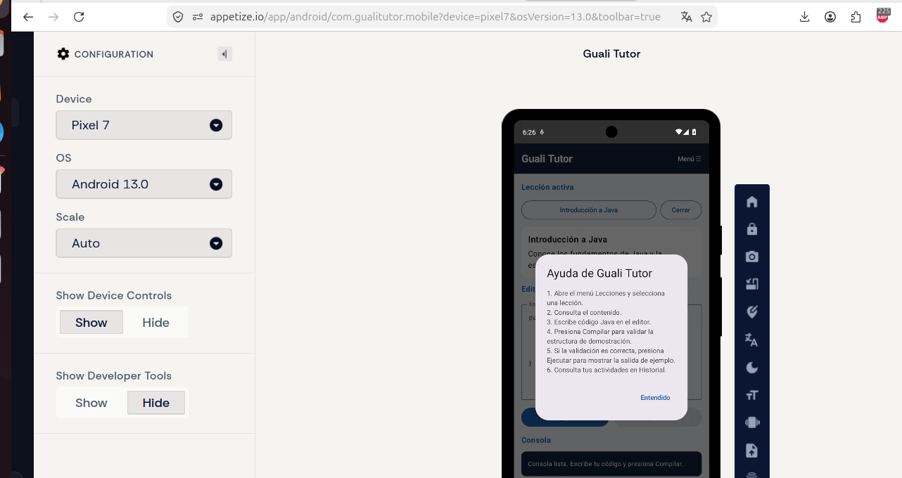
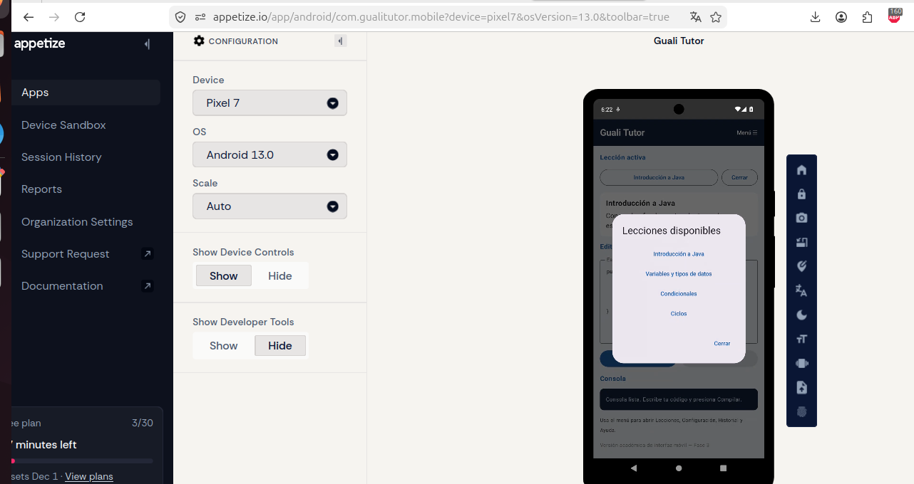
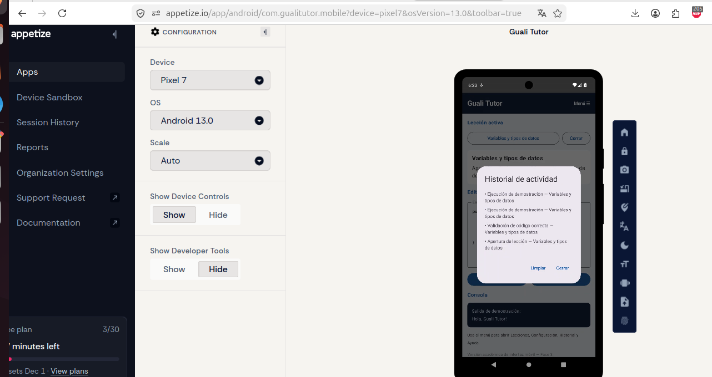
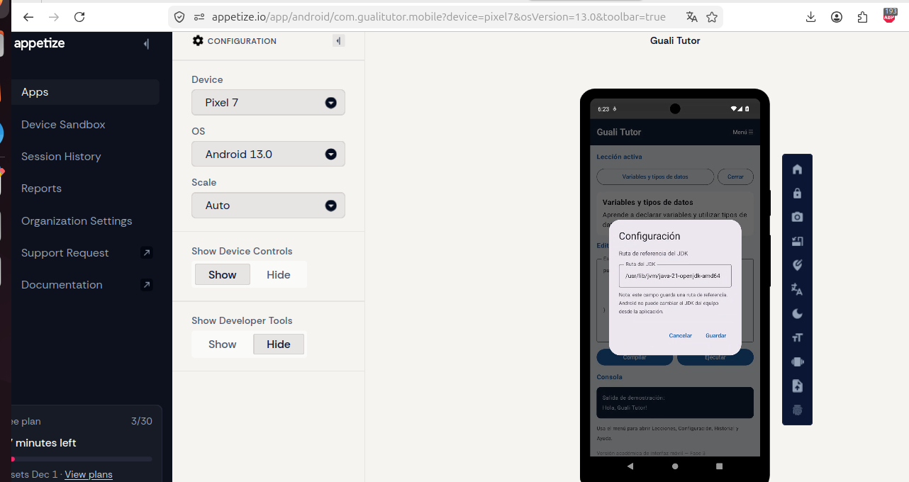
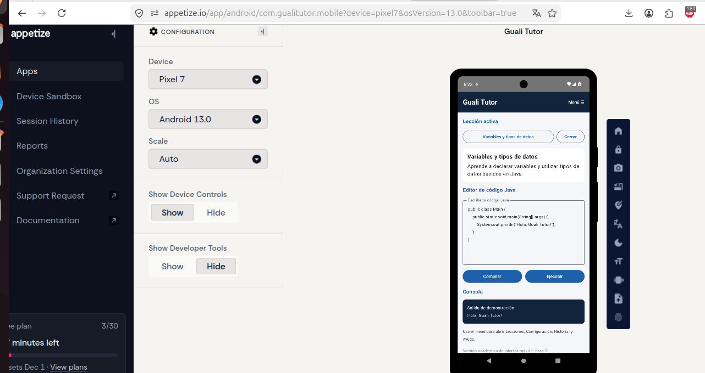

# Tutorial de creación del Front-End Android de Guali Tutor

**Proyecto:** Guali Tutor Mobile  
**Fase:** 3  
**Tecnologías:** Kotlin, Jetpack Compose, Android Gradle Plugin y GitHub Actions

## 1. Objetivo

Construir la interfaz móvil de Guali Tutor para que el estudiante pueda seleccionar una lección, consultar su contenido, escribir código Java, solicitar una compilación de demostración y consultar la salida en una consola.

> **Alcance de esta versión:** esta entrega implementa la interfaz y el flujo visual de demostración. Los botones Compilar y Ejecutar no invocan todavía un compilador Java real dentro de Android; la compilación del proyecto Android se realiza mediante GitHub Actions.

## 2. Requisitos previos

- Cuenta de GitHub.
- Navegador web actualizado.
- Conexión a Internet.
- Repositorio público para almacenar el proyecto.
- Para abrir y modificar el proyecto localmente: Android Studio, JDK 17 y conexión a Internet para descargar Gradle y las dependencias.
- Para generar el APK sin instalar Android Studio en el equipo: GitHub Actions habilitado en el repositorio.

## 3. Software y herramientas

### 3.1 GitHub

GitHub permite guardar el código fuente y mantener el historial de cambios.

1. Ingresar a `https://github.com`.
2. Iniciar sesión.
3. Crear un repositorio público llamado `GualiTutorMobile`.
4. Confirmar la creación del repositorio.

**Captura 1.** Insertar una captura del repositorio público `GualiTutorMobile`.

### 3.2 Android Studio (para desarrollo local)

Android Studio es el entorno recomendado para abrir el proyecto Android en una computadora compatible.

1. Ingresar a `https://developer.android.com/studio`.
2. Descargar Android Studio para el sistema operativo correspondiente.
3. Ejecutar el instalador y seguir el asistente.
4. En el asistente inicial, instalar Android SDK y las herramientas recomendadas.
5. Abrir el proyecto mediante **Open** y seleccionar la carpeta raíz que contiene `settings.gradle.kts`.

**Nota:** la compilación de esta entrega se ejecuta en GitHub Actions; no es necesario instalar Android Studio para repetir la compilación en la nube.

## 4. Crear la estructura del proyecto

En el repositorio se agregan los siguientes archivos y carpetas:

```text
GualiTutorMobile/
├── .github/
│   └── workflows/
│       └── android.yml
├── app/
│   ├── src/
│   │   └── main/
│   │       ├── java/com/gualitutor/mobile/
│   │       │   └── MainActivity.kt
│   │       └── AndroidManifest.xml
│   └── build.gradle.kts
├── build.gradle.kts
├── gradle.properties
├── settings.gradle.kts
└── README.md
```

1. Crear la carpeta `app`.
2. Agregar `settings.gradle.kts` para incluir el módulo `app`.
3. Agregar el archivo Gradle raíz `build.gradle.kts`.
4. Agregar `gradle.properties`.
5. Dentro de `app`, agregar `build.gradle.kts`.
6. Crear el paquete `com.gualitutor.mobile`.
7. Agregar `MainActivity.kt` y `AndroidManifest.xml`.

**Captura 2.** Insertar una captura de la estructura de archivos del repositorio en GitHub.

## 5. Configurar el módulo Android

En `app/build.gradle.kts` se configuran:

- El identificador de paquete `com.gualitutor.mobile`.
- `compileSdk = 35`.
- `minSdk = 23`.
- `targetSdk = 35`.
- Java y Kotlin con destino JVM 17.
- Las dependencias de Jetpack Compose y Material 3.

La configuración de compatibilidad Java/Kotlin debe utilizar la misma versión:

```kotlin
compileOptions {
    sourceCompatibility = JavaVersion.VERSION_17
    targetCompatibility = JavaVersion.VERSION_17
}

kotlin {
    compilerOptions {
        jvmTarget.set(
            org.jetbrains.kotlin.gradle.dsl.JvmTarget.JVM_17
        )
    }
}
```

**Captura 3.** Insertar una captura del archivo `app/build.gradle.kts` donde se vea la configuración Java/Kotlin.

## 6. Diseñar la interfaz principal

La interfaz se desarrolla en `MainActivity.kt` mediante Jetpack Compose.

### 6.1 Barra superior y navegación

Se utiliza `Scaffold` y `TopAppBar` para mostrar el título **Guali Tutor**, además de accesos a Historial y Ayuda.

### 6.2 Selección de lección

Se utiliza `ExposedDropdownMenuBox` para mostrar las lecciones disponibles:

- Introducción a Java.
- Variables y tipos de datos.
- Condicionales.
- Ciclos.

Al seleccionar una opción, se actualiza el título de la lección activa.

### 6.3 Contenido de la lección

Una tarjeta (`Card`) muestra el nombre de la lección y una breve descripción del contenido.

### 6.4 Editor de código

Un `OutlinedTextField` permite escribir y modificar el ejemplo de código Java.

### 6.5 Botones Compilar y Ejecutar

- **Compilar:** verifica la estructura básica del ejemplo y muestra un mensaje de demostración.
- **Ejecutar:** permanece deshabilitado hasta que la comprobación de demostración sea satisfactoria; después muestra una salida de ejemplo.

**Importante:** esta lógica es demostrativa. No compila ni ejecuta código Java arbitrario en el dispositivo.

### 6.6 Consola

Una tarjeta muestra los mensajes de compilación o la salida de demostración.

### 6.7 Configuración, historial y ayuda

- Configuración: muestra un campo editable para la ruta del JDK.
- Historial: muestra información de la sesión actual.
- Ayuda: presenta instrucciones breves de uso.

**Captura 4.** Insertar una captura de la interfaz Android en ejecución o una vista previa real de Android Studio. No sustituirla por una imagen ilustrativa.











## 7. Configurar la compilación automática en GitHub Actions

1. Abrir el repositorio `GualiTutorMobile`.
2. Seleccionar la pestaña **Actions**.
3. Elegir la opción para crear un workflow propio.
4. Crear el archivo `.github/workflows/android.yml`.
5. Configurar el workflow para preparar JDK 17, configurar Gradle, ejecutar `assembleDebug` y publicar el APK como artefacto.
6. Guardar los cambios mediante **Commit changes**.

El workflow ejecuta la compilación en un entorno Ubuntu alojado por GitHub.

**Captura 5.** Insertar una captura del workflow `Android CI` finalizado correctamente.

## 8. Generar y descargar el APK

1. Abrir **Actions** en el repositorio.
2. Seleccionar la ejecución exitosa de `Android CI`.
3. Abrir el resumen de la ejecución.
4. En la sección **Artifacts**, seleccionar `GualiTutor-debug-apk`.
5. Descargar el archivo ZIP y extraer `app-debug.apk`.

**Captura 6.** Insertar una captura del resumen de GitHub Actions donde aparezcan `Success` y el artefacto publicado.

## 9. Resultado

El repositorio contiene el código fuente del proyecto Android y un workflow de GitHub Actions que compila el módulo de aplicación y publica el APK de depuración como artefacto descargable.

## 10. Observaciones

La interfaz implementa los componentes visuales principales para la experiencia móvil. Para una versión funcional completa todavía se requiere conectar el editor con un servicio real de compilación y ejecución Java, persistir el historial y las lecciones, y permitir seleccionar una ruta JDK válida según la plataforma.
